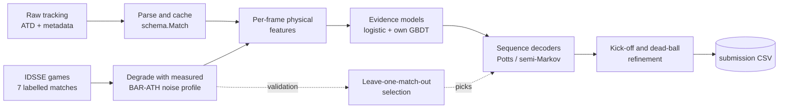

<div align="center">

# ⚽ mtah-possession

### Frame-level ball possession from noisy tracking data, built from scratch on NumPy

**More than a Hack 2027 · Phase 1 · FC Barcelona vs Athletic Club**


[Overview](#-overview) ·
[Rules we followed](#-rules-this-repository-is-built-around) ·
[How it works](#-how-it-works) ·
[Quick start](#-quick-start) ·
[Reproduce](#-regenerating-the-submission) ·
[Layout](#-repository-layout) ·
[Team](#-team)

</div>

---

## 🔭 Overview

For every frame of the match we predict who has the ball: **home**, **away**, or **dead ball**. The tracking data is degraded (the ball is often missing or misplaced), so a nearest-player rule is a weak baseline.

Our approach:

1. **Simulate the problem.** Clean, human-labelled IDSSE games are degraded to look like this match's tracker, giving us a labelled validation set that resembles the real data.
2. **Score frames with evidence models.** Per-frame physical features feed two models (logistic regression and our own gradient boosting) that output H / A / D evidence.
3. **Decode whole sequences.** Potts and semi-Markov decoders turn noisy per-frame evidence into clean possession spells.
4. **Stay honest.** Every design choice is made on simulated games, never tuned on the public window.

Everything, including the logistic regression, the gradient boosting and the decoders, is written in NumPy. No kloppy, no pandas at runtime.

> **Current status: Phase 9.** Simulated games now lose the ball where the real tracker does (see [`docs/specs/phase9.md`](docs/specs/phase9.md)). Each phase is specified, with results, in [`docs/specs/`](docs/specs/).

## 📜 Rules this repository is built around

| | Rule |
|---|---|
| 🤖 | **Labels come from code, never from a person.** Real frames were looked at (permitted by the organisers) only to check specific decisions, such as whether a filled ball position is the ball or whether play is stopped. They were never used to produce labels or train a model. |
| 🧪 | **The public 5 minutes are a pipeline check, not a tuning set.** Every design choice is made on the simulated IDSSE games (`evaluate --on sim`). |
| 🔒 | **The match data is never committed.** `.gitignore` excludes `data/`, `cache/` and every CSV. |
| 🖥️ | **Frame-level data stays on the participant's machine.** Progress is reported as PASS/FAIL verdicts and aggregate numbers. |

## 🧠 How it works



The noise profile is measured from the BAR-ATH tracking without labels. Phase 9 makes the simulator game-state-aware, so the ball drops out where the real tracker drops it, in live play and in stoppages.

## 📊 Results

Exact figures reproduced by the repository (`possession/phase1.py` selection and `docs/specs/phase9.md`):

| Method | Setting | Score (spellF1 / macroF1) | 90% interval (T=1s) |
|---|---|---|---|
| Nearest-player baseline (`w=50`) | simulated games (LOMO) | 0.2740 (mean) | [0.2744, 0.2886] |
| **Ours (Phase 9)** | simulated games (LOMO) | **0.5972** (mean) | **[0.5970, 0.6200]** |
| Nearest-player baseline (`w=50`) | public 5-minute window | 0.3256 / 0.6207 | n/a |
| **Ours (Phase 9)** | public 5-minute window (pipeline check only) | **0.5620 / 0.8260** | n/a |

*LOMO objective is the mean pooled `spellF1` over control thresholds 0, 0.5, 1, and 2s across all 7 held-out IDSSE matches (+0.040 over Phase 6 across 7/7 folds).*

## 🚀 Quick start

### 1. Environment and dependencies

```bash
python -m venv .venv

# Linux / macOS:
source .venv/bin/activate
# Windows PowerShell:
.\.venv\Scripts\Activate.ps1

pip install -r requirements.txt          # numpy
pip install -r requirements-dev.txt      # pytest + pandas (pandas only for check-scorer)
```

### 2. Environment variables

Point these at your local paths.

```powershell
# Windows PowerShell example:
$env:MTAH_DATA_DIR  = "C:\path\to\dataset"                 # folder containing tactical/ and broadcast/
$env:MTAH_REPO_DIR  = "C:\path\to\more-than-a-hack-2027"   # official repo clone (for checks)
$env:MTAH_CACHE_DIR = ".\cache"                            # local cache directory
```

```bash
# bash:
export MTAH_DATA_DIR="/path/to/dataset"
export MTAH_REPO_DIR="/path/to/more-than-a-hack-2027"
export MTAH_CACHE_DIR="./cache"
```

### 3. Generate and validate the final submission CSV

To regenerate the official submission file directly from cached features and models:

```bash
# Generate submission CSV (takes ~6 min)
python -m possession predict --team "Gradient Descendants"

# Validate format, row count, value ranges, dtypes, and file size
python validate_submission.py "submissions\Gradient Descendants.csv"
```

Expected output hash: SHA-256 `28f7229f96045c50` (identical on Linux and Windows).

## 🔁 Regenerating the submission

Two stages. Stage 1 is the Phase 6 pipeline. Its labels only tell stage 2 where play is stopped, so the simulator can measure how BAR-ATH's tracker sees the ball in live play and in stoppages.

```powershell
# stage 1 (Phase 6, state-blind simulator)
python -m possession noise-profile
python -m possession simulate --world phase6
python -m possession phase1-select
python -m possession predict --out stage1
copy "stage1\Gradient Descendants.csv" cache\stage1_labels.csv

# stage 2 (Phase 9)
python -m possession state-profile --labels cache\stage1_labels.csv
python -m possession simulate               # --world state is the default
python -m possession phase1-select          # or split: --folds J03WMX J03WN1 ... then --merge
python -m possession predict                # writes "submissions/Gradient Descendants.csv"
```

Stage 1 must reproduce SHA-256 `edde29db13a56e2d` (the Phase 6 upload). Stage 2's hash is in [`docs/specs/phase9.md`](docs/specs/phase9.md).

**Reproducibility.** Decoding runs in integer fixed-point arithmetic and fitted parameters are rounded far above floating-point noise, so the same data should give the same file on every platform. Verified: Linux / numpy 2.2.6 and Windows / numpy 2.5.4 give the identical SHA-256.

<details>
<summary><b>🧱 Phase 0, in order</b> (parsing, scorer re-implementation, simulator)</summary>

<br>

| step | command | what PASS means |
|---|---|---|
| 0 | `python -m pytest -q tests` | parsers, metrics and simulator correct on synthetic files (with `MTAH_REPO_DIR` set, also checks the README baseline scores) |
| 1 | `python -m possession build-cache` | ATD parsed: 199,319 records, 46 slots, home = Barcelona, published ball-coverage and object-count figures matched, 638 tags, both kickoffs inside their tags |
| 2 | `python -m possession check-baseline` | our parse + nearest-player baseline reproduce the four committed baseline CSVs **frame for frame**, and their README scores |
| 3 | `python -m possession check-scorer` | our metrics equal the official `possession_metrics.py` on the baselines + 200 random perturbations |
| 4 | `python -m possession idsse-download` | 7 IDSSE matches fetched from figshare (~2.4 GB) into `cache/idsse_raw` |
| 5 | `python -m possession idsse-build` | each match parsed into a clean labelled Match |
| 6 | `python -m possession noise-profile` | BAR-ATH's tracking degradation measured (unsupervised) |
| 7 | `python -m possession simulate` | every IDSSE match degraded with that profile, 2 seeds; simulated ball coverage and objects/team within tolerance of BAR-ATH |
| 8 | `python -m possession evaluate` | baseline scored on simulated games (with a 90% bootstrap interval) and on the public window |

Steps 5–8 in one go, after the download: `python -m possession phase0`.

</details>

<details>
<summary><b>🧩 Phase 1, in order</b> (evidence models, decoders, first submission)</summary>

<br>

| step | command | what PASS means |
|---|---|---|
| 1 | `python -m pytest -q tests` | relabelling, logistic fit and both decoders correct on synthetic sequences |
| 2 | `python -m possession phase1-select` | leave-one-match-out grid over Potts + semi-Markov decoders; the chosen one beats the baseline with non-overlapping 90% intervals (10–30 min) |
| 3 | `python -m possession predict --team <TEAM>` | `submissions/<TEAM>.csv` written, well-formed, deterministic; run twice and compare the sha256 |
| 4 | `python -m possession validate submissions/<TEAM>.csv` | official-style format check of the exact file to upload |

Any submission file can be checked with `python -m possession validate <file.csv>`. Every command ends with `N PASS, N FAIL, N INFO` and lists the failures.

</details>

<details>
<summary><b>👁️ Vision (experimental): ball detection on the tactical video</b></summary>

<br>

Runs on your own GPU in a **separate environment** (PyTorch needs CUDA 12.8+ builds for RTX 50 cards and does not yet support every new Python). The video never leaves your machine; only per-frame ball candidates are written to `cache/vision/`.

```powershell
pip install uv
uv python install 3.12
uv venv --python 3.12 .venv-vision
.\.venv-vision\Scripts\Activate.ps1
uv pip install torch torchvision --index-url https://download.pytorch.org/whl/cu128
uv pip install ultralytics==8.4.187 opencv-python numpy pytest
python -c "import torch; print(torch.__version__, torch.cuda.is_available(), torch.cuda.get_device_name(0))"

python -m possession vision-detect --mode sample --model yolo11m.pt
python -m possession vision-validate --mode sample --model yolo11m.pt
```

`vision-validate` compares detections with the tracker's ball where the tracker sees it (recall, share within 2 m / 4 m, median error) and reports how many tracker-missing frames a detection could fill, per confidence threshold.

</details>

## 🗂️ Repository layout

```
possession/
  config.py           published constants, paths (env vars)
  schema.py           Match: the one representation every source and method shares
  metrics.py          spellF1 / macroF1 / transitions, pooled scoring, bootstrap
  harness.py          run a method over labelled matches (labels hidden from the method)
  io/atd.py           EPTS metadata (DataFormatSpecification) + raw ATD -> Match
  io/tagging.py       Smart Tagging -> frame intervals
  io/labels.py        submission CSV read / write
  io/idsse.py         IDSSE DFL XML -> labelled Match (BallStatus / BallPossession)
  noise/profile.py    measure tracking degradation from BAR-ATH (no labels)
  noise/simulate.py   impose it on clean external games
  noise/state.py      phase 9: game-state-aware ball dropout, carried-then-resting dead ball
  methods/baseline.py starter baseline, for reproduction and as the floor
  relabel.py          competition possession rule applied to external labels
  features.py         per-frame physical features (no labels)
  logistic.py         IRLS logistic regression
  emission.py         per-frame H / A / D evidence from two logistic models
  decode.py           Potts and semi-Markov decoders, boundary refinement, priors
  phase1.py           leave-one-match-out selection (resumable), shift guard, prediction
  gbdt.py             own histogram gradient boosting (deterministic, numpy only)
  kickoff.py          period-start kick-offs from Smart Tagging; pre-kick-off dead ball
docs/specs/           approved phase specs (frozen)
tests/                synthetic-format fixtures + tests
tools/                helper scripts
```

Further reading in the repo root: [`WHAT_WE_BUILT.md`](WHAT_WE_BUILT.md) · [`CHANGES.md`](CHANGES.md) · [`PROPOSED_IMPROVEMENTS.md`](PROPOSED_IMPROVEMENTS.md)

## 📚 External data

IDSSE: Bassek, Weber, Rein & Memmert (2025), *An integrated dataset of spatiotemporal and event data in elite soccer*, Scientific Data 12:195, [doi:10.1038/s41597-025-04505-y](https://doi.org/10.1038/s41597-025-04505-y). Seven 2022-23 Bundesliga / 2. Bundesliga matches; per-frame ball status and possession from DFL's official positional data. Human-curated data about **other** games, which `RULES.md` allows for training and validation.

## 👥 Team

**Gradient Descendants**

| Member | GitHub |
|---|---|
| Asish Kumar Patra | [@ultron513](https://github.com/ultron513) |
| Ayush Das | [@AyushDas-30](https://github.com/AyushDas-30) |
